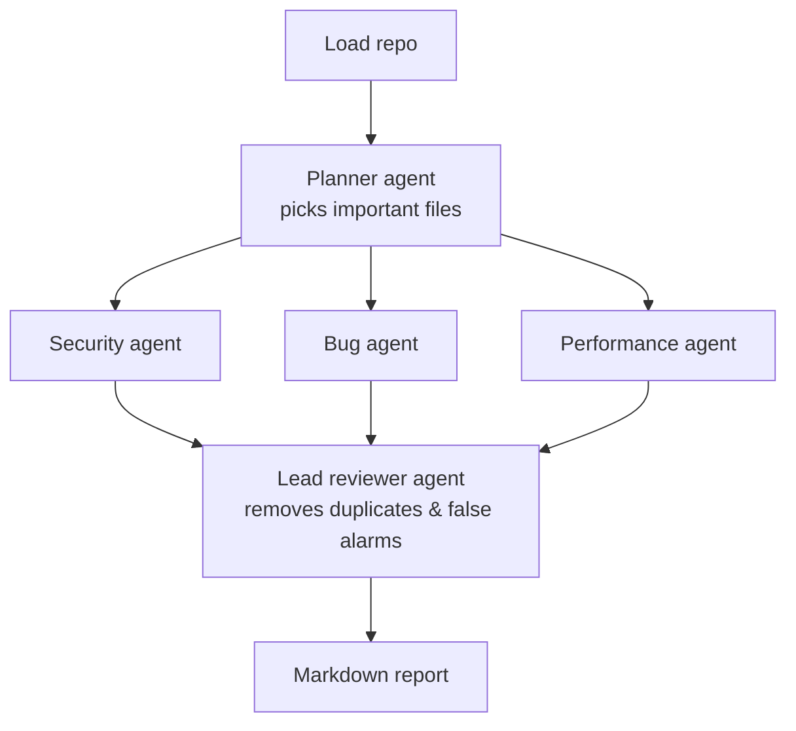

# Code Review Agent

[](https://github.com/ranjangreddy/code-review-agent/actions/workflows/ci.yml)

An AI code reviewer made of several agents working together, built with **LangGraph**.

Point it at a folder or a GitHub repo, and it writes a review report listing security holes, bugs and
performance problems, with file names, line numbers and fixes.

It works with **any LLM**: Claude, GPT, Gemini, or free local models through Ollama.

## How it works



1. **Load:** reads the source files and skips `node_modules`, build output and huge files.
2. **Plan:** a planner agent works out what the project is and which files matter most.
3. **Review:** three specialist agents review the code **at the same time**, each focusing on one area.
4. **Merge:** a lead reviewer removes duplicates and false alarms, ranks the issues, and writes a summary.
5. **Report:** the result is saved as a Markdown file.

## Quick start

```bash
git clone https://github.com/ranjangreddy/code-review-agent
cd code-review-agent
uv sync                       # installs dependencies (https://docs.astral.sh/uv/)
cp .env.example .env          # then add your API key
```

Review a local folder or a GitHub repo:

```bash
uv run code-review ./my-project
uv run code-review https://github.com/owner/repo
```

Example output:

```
📂 Loaded 42 source files
🧭 Planner picked 18 files → 2 batch(es)
   ✓ security reviewer: 5 finding(s)
   ✓ bugs reviewer: 4 finding(s)
   ✓ performance reviewer: 2 finding(s)
🧑‍⚖️ Lead reviewer kept 8 finding(s)

Report written to code-review-report.md
```

## Use any model

Pick the model with `--model provider:model-name` (LangChain format):

| Provider | Example | Setup |
|---|---|---|
| Anthropic (default) | `--model anthropic:claude-opus-5` | `ANTHROPIC_API_KEY` in `.env` |
| OpenAI | `--model openai:<model-name>` | `uv sync --extra openai`, set `OPENAI_API_KEY` |
| Google Gemini | `--model google_genai:<model-name>` | `uv sync --extra google`, set `GOOGLE_API_KEY` |
| Ollama (free, local) | `--model ollama:llama3.2` | `uv sync --extra ollama`, install [Ollama](https://ollama.com) |

Small local models work but miss more issues than large models.

## Options

```bash
uv run code-review ./my-project \
  --model anthropic:claude-opus-5 \
  --specialists security,bugs \        # only run some reviewers
  --max-files 40 \                     # how many files the planner may pick
  --concurrency 4 \                    # how many LLM calls run at once
  --out review.md
```

## LangGraph Studio

See the graph visually and step through a run:

```bash
uv run --with "langgraph-cli[inmem]" langgraph dev
```

## Tests

```bash
uv run pytest
```

The tests use a fake LLM, so they run offline in under a second with no API key. They cover:
- the full pipeline
- parallel fan-out (one reviewer per specialist × batch)
- a reviewer failing without crashing the run
- the planner failing and falling back to all files
- file loading and batching

`tests/fixtures/vulnerable_app` is a small, deliberately insecure app to try the reviewer on:

```bash
uv run code-review tests/fixtures/vulnerable_app
```

## Project structure

| File | What it does |
|---|---|
| `graph.py` | **Start here.** The LangGraph workflow: agents and how they connect |
| `prompts.py` | Instructions for each agent |
| `models.py` | The exact output format each agent must return (Pydantic) |
| `llm.py` | Picks the model, for any provider |
| `repo.py` | Loads files from a folder or GitHub |
| `report.py` | Builds the Markdown report |
| `cli.py` | The `code-review` command |

## Key LangGraph ideas used

- **StateGraph:** the steps are nodes that share one state object.
- **Send API (fan-out):** runs one reviewer task per specialist × batch, all in parallel.
- **Reducers:** `Annotated[list, operator.add]` merges the findings from the parallel reviewers.
- **Conditional edges:** if there's nothing to review, it skips the reviewers.
- **Structured output:** every agent returns validated Pydantic objects, not free text.

## License

MIT
